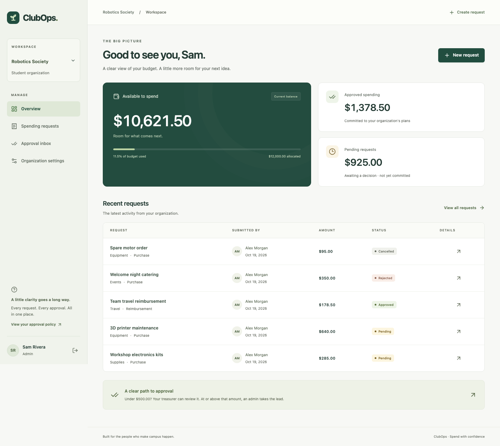

# ClubOps

**Organization spending, without the spreadsheet shuffle.**

ClubOps gives student organizations one place to request purchases and reimbursements, review spending, and understand their remaining budget. Members submit requests; treasurers and admins make decisions; everyone can follow the history.

A focused full-stack portfolio MVP designed for roughly **33–40 hours of student development**. Its central engineering problem is making approvals correct under authorization checks, concurrent requests, and retries.



## What works

- Django session login with member, treasurer, and admin demo accounts.
- Isolated organization workspaces, membership roles, and server-enforced permissions.
- Purchase and reimbursement requests with validation, categories, filters, pagination, details, and history.
- Approval inbox based on each request's captured approver role.
- Admin-configurable thresholds; existing requests retain their original approval requirements.
- Total, approved, pending, and remaining budget summaries from PostgreSQL.
- Transactional approvals with row locks: concurrent requests cannot overspend.
- Retry-safe approve/reject/cancel actions with one audit event per transition.
- Responsive React UI, generated GraphQL types, useful errors, loading states, and empty states.
- PostgreSQL backend tests, two real Playwright workflows, and GitHub Actions checks.

## Stack and structure

React 19 · TypeScript · Vite · Tailwind CSS 4 · Apollo Client 4 · Python 3.12 · Django 5.2 · Strawberry GraphQL · PostgreSQL 17 · pytest/pytest-django · Playwright · Docker Compose

```text
clubops/
├── backend/
│   ├── accounts/          # Django session endpoints
│   ├── config/            # Settings, URL routing, WSGI
│   ├── core/              # GraphQL schema and domain errors
│   ├── organizations/     # Organization and membership models
│   ├── requests_app/      # Requests, audit events, services, seed command
│   ├── tests/             # Permissions, lifecycle, API, PostgreSQL races
│   └── schema.graphql     # Exported schema used by client code generation
├── frontend/
│   ├── src/components/    # Shared UI and workspace shell
│   ├── src/pages/         # Product screens
│   ├── src/graphql/       # Operations, generated types, Apollo client
│   ├── src/hooks/         # Session authentication
│   ├── scripts/           # GraphQL code generation
│   └── e2e/               # Two end-to-end browser workflows
├── docs/                  # Architecture, progress, screenshots
├── .github/workflows/ci.yml
├── docker-compose.yml
└── .env.example
```

The browser talks to Vite on port 5173. Vite proxies `/api/` and `/graphql/` to Django on port 8000. Django owns all permissions and business rules; PostgreSQL owns durable state and row locks. See [architecture and correctness](docs/ARCHITECTURE.md) for the state machine, role matrix, transaction algorithm, and tradeoffs.

## Quick start: Docker Compose

Prerequisites: Git and Docker with the Compose plugin. Start Docker Desktop first if using macOS or Windows.

From the repository root:

```sh
cp .env.example .env
docker compose up --build
```

Wait for migrations, the demo seed message, and Vite's ready message. Open **[http://localhost:5173](http://localhost:5173)**.

The startup command migrates the database and seeds the demo automatically. The seed command is rerunnable and preserves existing accounts, requests, decisions, and budgets. The named PostgreSQL volume persists data when containers are recreated. Compose binds published ports to loopback for local use.

Stop with `Ctrl+C`, or use:

```sh
docker compose down
```

This preserves database contents. If port 5432 is already occupied, set `POSTGRES_PORT=55433` in `.env`; Compose still uses port 5432 internally. Ports 8000 and 5173 must be free.

### Development-only demo accounts

All accounts initially use **`ClubOps-demo-2026!`**. These credentials are intentionally public demo credentials, not production secrets.

| Username | Name | Robotics Society | Outdoor Collective |
|---|---|---|---|
| `member` | Alex Morgan | Member | No access |
| `treasurer` | Jordan Lee | Treasurer | No access |
| `admin` | Sam Rivera | Admin | Admin |
| `outsider` | Taylor Chen | No access | Member |

The Robotics Society starts with a $12,000 budget and $500 admin threshold. Outdoor Collective starts with $6,500 and a $300 threshold. Seed data includes eight requests spanning pending, approved, rejected, and cancelled states, with real audit events and matching approved totals. An admin can switch between both organizations.

Set `DEMO_PASSWORD` before the first seed to change the initial password. Reseeding **does not reset existing passwords**. Demo seeding requires `DJANGO_DEBUG=true`.

Try this walkthrough:

1. Sign in as `member`, create a request for $25.75, and inspect its pending state and submission history.
2. Sign out and sign in as `treasurer`. Open the approval inbox and approve the request.
3. Inspect the updated budget and the request's two audit events.
4. Submit a request for $500 or more; it requires `admin` review. Change the threshold as `admin` to see that existing requests retain their original approver.
5. Sign in as `outsider` to see only the Outdoor Collective workspace.

## Local development without app containers

Prerequisites: Python 3.12+, Node.js 22+, npm, and PostgreSQL 17. The database role must have `CREATEDB` for pytest's isolated test database.

You may run only the database through Compose:

```sh
cp .env.example .env
docker compose up -d db
```

Or create a local PostgreSQL role/database with the same `.env` credentials. For example, as a local PostgreSQL administrator:

```sh
createuser --pwprompt --createdb clubops
createdb --owner=clubops clubops
```

Set the matching host, port, username, and password in `.env`. Then, from the repository root, in a POSIX shell:

```sh
python3.12 -m venv .venv
source .venv/bin/activate
pip install -r backend/requirements.txt
set -a
source .env
set +a
python backend/manage.py migrate
python backend/manage.py seed_demo
python backend/manage.py runserver 127.0.0.1:8000
```

In a second terminal:

```sh
cd frontend
npm ci
npm run dev
```

Open [http://localhost:5173](http://localhost:5173). Python settings read environment variables; they do not automatically load `.env`. Export it in each backend terminal. On Windows, use WSL for the shell instructions or Compose for the full application.

The frontend dev server proxies to `http://127.0.0.1:8000` by default. Override `API_PROXY_TARGET` when the backend runs elsewhere. Containers use `http://backend:8000`. Keep browser and API behind the same origin; no permissive CORS setup is needed.

## Run checks

### Backend (local Python environment)

Export `.env` as above, then:

```sh
python backend/manage.py check
python backend/manage.py makemigrations --check --dry-run
pytest backend/tests -q
```

All tests use PostgreSQL. The suite includes thread-based tests with independent connections and forced lock contention; it never substitutes SQLite. pytest creates/destroys a separate `test_clubops` database and does not use the demo application's data.

### Backend (Compose)

With the database and backend running:

```sh
docker compose exec backend pytest tests -q
docker compose exec backend python manage.py check
```

### Frontend

```sh
cd frontend
npm ci
npm run typecheck
npm run build
npm run format:check
npm audit
```

The build writes `frontend/dist/`. The Compose frontend deliberately uses Vite for local development; this repository does not include public hosting or a production static server.

### Browser workflows

Run a seeded Django backend on port 8000 first. These tests exercise the actual backend and **add one $25.75 approved request** to the selected demo database on a successful full run. Use development data only. If running all of Compose, its frontend can be reused by the local test runner.

```sh
cd frontend
npm ci
npx playwright install chromium
npm run test:e2e
```

Playwright starts Vite if needed. The two tests cover login/errors/dashboard/mobile/logout and member submission → treasurer approval → persistent budget/history. Failed runs retain screenshots and traces. View the report with `npx playwright show-report`.

### Regenerate GraphQL types

After changing the schema or client operations, from the root with the Python environment active and `.env` exported:

```sh
python backend/manage.py shell -c 'from core.schema import schema; from pathlib import Path; Path("backend/schema.graphql").write_text(schema.as_str())'
npm run codegen --prefix frontend
npm run typecheck --prefix frontend
```

Do not manually edit `frontend/src/graphql/generated.ts`. The small generation script uses [GraphQL Code Generator's official core API](https://the-guild.dev/graphql/codegen/docs/advanced/programmatic-usage). The operations plugin generates input/enums and operation types; the typed-document plugin generates Apollo-compatible documents.

GitHub Actions runs PostgreSQL tests, migration/schema drift checks, TypeScript/build checks, and both browser workflows on push and pull request. It requires no paid service or repository secrets. See [progress and executed results](docs/PROGRESS.md) for the tests actually run during implementation.

## API overview

| Endpoint | Purpose |
|---|---|
| `GET /api/session/` | Current session and initial CSRF cookie |
| `POST /api/login/` | Django username/password session login |
| `POST /api/logout/` | End the session |
| `POST /graphql/` | Typed application queries and mutations |

GraphQL queries: `me`, `organizations`, `organization`, `requests`, `request`.

Mutations: `createRequest`, `approveRequest`, `rejectRequest`, `cancelRequest`, `updateApprovalThreshold`.

All domain operations except the nullable `me` field require an authenticated session. Every write requires a valid CSRF token. Queries are POST-only. Monetary values use decimal strings, not JavaScript arithmetic.

Example request creation:

```graphql
mutation Create($input: CreateRequestInput!) {
  createRequest(input: $input) {
    id
    status
    requiredRole
    amount
  }
}
```

```json
{
  "input": {
    "organizationId": 1,
    "title": "Workshop sensor kits",
    "description": "Reusable sensor kits for next month's workshop.",
    "amount": "125.50",
    "category": "SUPPLIES",
    "requestType": "PURCHASE"
  }
}
```

Use actual IDs returned by `organizations`. Request categories are `EVENTS`, `EQUIPMENT`, `TRAVEL`, `SUPPLIES`, and `OTHER`; types are `PURCHASE` and `REIMBURSEMENT`. Request lists accept `status`, `inboxOnly`, `limit` (1–100), and `offset`.

Expected errors carry `extensions.code`: `UNAUTHENTICATED`, `NOT_FOUND`, `FORBIDDEN`, `INVALID_INPUT`, `INVALID_TRANSITION`, or `INSUFFICIENT_BUDGET`. Unexpected resolver failures return a generic message. The frontend renders useful business errors inline.

## Decisions and scope limits

- One approval stage. Threshold equality requires admin approval. An admin can also perform treasurer-level approvals.
- All members can read their organization's requests and audit history. Only submitters can cancel their own pending requests. Approvers may review their own requests; no separation-of-duties rule was requested.
- Pending requests do not reserve budget. Approval commits money; rejection/cancellation commits nothing. Approved requests cannot be reversed in this MVP.
- Retrying the same authorized terminal action is safe. A conflicting terminal action fails. Creation has no idempotency key; after an uncertain submission, check the list before submitting again.
- Money is USD only. Budgets and membership provisioning are seeded. Settings change the approval threshold, not the allocated budget.
- No payments, uploads, notifications, invitations, live subscriptions, analytics platform, or multistage workflow engine.
- Query pagination is capped and depth limited; broad GraphQL cost controls and login rate limiting are not included. This is a local portfolio demo, not a hardened public financial service.
- Before public deployment, configure TLS, unique secrets, secure hosts/origins, rate limiting, backups, monitoring, and production static serving. Never deploy the public demo credentials or the sample secret.

## Screenshots and implementation record

- [Desktop dashboard](docs/screenshots/dashboard.png)
- [Request details and audit history](docs/screenshots/request-detail.png)
- [Mobile dashboard](docs/screenshots/mobile.png)
- [Architecture and correctness](docs/ARCHITECTURE.md)
- [Milestones, executed tests, and handoff](docs/PROGRESS.md)
